<div align="center">

# Advanced Production RAG & Autonomous AI Agents Suite

**A comprehensive, production-grade engineering suite showcasing modern Retrieval-Augmented Generation (RAG) architectures — from Lexical + Semantic Hybrid Search and Reciprocal Rank Fusion to Multi-Step Autonomous Research Agents and Financial Filing Intelligence.**

[](https://github.com/FresherMen)
[](https://www.linkedin.com/in/ankur-pal-2b2ba9433)
[](LICENSE)
[](https://www.python.org/)
[](https://fastapi.tiangolo.com/)
[](https://react.dev/)
[](https://www.docker.com/)

</div>

---

## Table of Contents

- [Architectural Evolution](#architectural-evolution)
- [Suite Projects Overview](#suite-projects-overview)
  - [1. DocMind v2: Enterprise Hybrid RAG](#1-docmind-v2-enterprise-hybrid-rag)
  - [2. Autonomous Research Agent](#2-autonomous-ai-research-agent)
  - [3. Financial Analyst 10-K RAG](#3-financial-analyst-sec-10-k-rag)
- [Comparative Architecture Matrix](#comparative-architecture-matrix)
- [Core Technologies & Stack](#core-technologies--stack)
- [Repository Structure](#repository-structure)
- [Quick Start Guide](#quick-start-guide)
- [Security & Production Best Practices](#security--production-best-practices)
- [Author & Connect](#author--connect)
- [License](#license)

---

## Architectural Evolution

This repository provides working, end-to-end reference implementations of the modern RAG paradigm across three distinct evolutionary tiers:

```mermaid
graph TD
    subgraph "Tier 1: Grounded Dense RAG"
        T1_Query[User Question] --> T1_Embed[MiniLM Embedding]
        T1_Embed --> T1_Vector[(Pinecone Vector DB)]
        T1_Vector --> T1_TopK[Top-K Dense Chunks]
        T1_TopK --> T1_LLM[Groq LLaMA 3.3 70B]
        T1_LLM --> T1_Streamlit[Streamlit UI]
    end

    subgraph "Tier 2: Production Hybrid RAG & Eval"
        T2_Query[User Question] --> T2_Expand[LLM Query Expansion]
        T2_Expand --> T2_Dense[(Dense ChromaDB)]
        T2_Expand --> T2_Sparse[Sparse BM25 Index]
        T2_Dense --> T2_RRF[Reciprocal Rank Fusion]
        T2_Sparse --> T2_RRF
        T2_RRF --> T2_Compress[Contextual Compression]
        T2_Compress --> T2_Gen[GPT-4o / LLaMA Generation]
        T2_Gen --> T2_Eval[RAGAS-Style Eval Metrics]
        T2_Eval --> T2_React[Full-Stack React + FastAPI]
    end

    subgraph "Tier 3: Autonomous Agentic RAG"
        T3_Goal[Complex Goal] --> T3_Loop{ReAct Reasoning Loop}
        T3_Loop -->|Tool: search_docs| T3_Chroma[(ChromaDB Docs)]
        T3_Loop -->|Tool: search_web| T3_Web[Live Web API]
        T3_Loop -->|Tool: save_note| T3_Notes[Markdown Notes]
        T3_Loop --> T3_Synth[Report Synthesis Engine]
        T3_Synth --> T3_UI[React 19 Research Dashboard]
    end
```



---

## Suite Projects Overview

### 1. DocMind v2: Enterprise Hybrid RAG
> **Location:** [`./01-DocMind-Hybrid-RAG`](./01-DocMind-Hybrid-RAG)  
> **Stack:** FastAPI, React 18, ChromaDB, BM25, Docker Compose, OpenAI / Groq

An enterprise-ready RAG application addressing real-world retrieval pitfalls:
- **Hybrid Search (Dense + Sparse):** Combines cosine semantic vectors with BM25 keyword matching using **Reciprocal Rank Fusion (RRF)**.
- **LLM Query Expansion:** Automatically generates multiple query variants to cover sparse embedding spaces.
- **Contextual Chunk Compression:** Filters out irrelevant noise from retrieved chunks before prompt assembly.
- **Automated RAGAS-Style Evaluation:** Scores every answer on **Faithfulness**, **Answer Relevancy**, and **Context Precision**.
- **Full Dockerized Deployment:** One-command setup with `docker-compose up --build`.

👉 **[Explore DocMind v2 Documentation & Guide &rarr;](./01-DocMind-Hybrid-RAG)**

---

### 2. Autonomous AI Research Agent
> **Location:** [`./02-Autonomous-Research-Agent`](./02-Autonomous-Research-Agent)  
> **Stack:** Python, FastAPI, Groq (Llama-3.3-70B), ChromaDB, React 19, Vite

An agentic research assistant designed for deep academic and technical investigation:
- **ReAct Agent Reasoning Loop:** Multi-step decision making with native Groq function calling.
- **Dynamic Tool Dispatch:** Autonomously executes document searches, live web searches, and file creation.
- **Automated Report Synthesizer:** Generates executive bullet summaries, research briefs, and multi-topic comparative analyses.
- **Modern React 19 UI:** Interactive research workspace with real-time feedback, note inspection, and document indexing.

👉 **[Explore Autonomous Research Agent Documentation & Guide &rarr;](./02-Autonomous-Research-Agent)**

---

### 3. Financial Analyst SEC 10-K RAG
> **Location:** [`./03-Financial-Analyst-RAG`](./03-Financial-Analyst-RAG)  
> **Stack:** LangChain, Pinecone Serverless, Groq, SentenceTransformers, Streamlit

A financial intelligence tool tailored for quantitative and qualitative analysis of corporate annual reports:
- **SEC 10-K Ingestion:** Automated extraction, recursive character chunking, and indexing of NVIDIA FY2024 Form 10-K.
- **Hallucination-Free Fact Extraction:** Configured with `temperature=0` for strict mathematical and factual integrity.
- **Source Passage Transparency:** Expandable source inspector revealing exact filing excerpts and page references.
- **Interactive Streamlit Workspace:** Preloaded with financial analysis prompts for instant metric evaluation.

👉 **[Explore Financial Analyst RAG Documentation & Guide &rarr;](./03-Financial-Analyst-RAG)**

---

## Comparative Architecture Matrix

| Architectural Dimension | Financial Analyst RAG | DocMind v2 Hybrid RAG | Autonomous Research Agent |
|---|---|---|---|
| **Primary Paradigm** | Grounded Dense RAG | Hybrid Dense + Sparse RAG | Agentic Multi-Step RAG |
| **Vector Store** | Pinecone Serverless | ChromaDB (Persistent) | ChromaDB (Disk-backed) |
| **Retrieval Strategy** | Dense cosine similarity | Dense (Chroma) + Sparse (BM25) | Dense vector search via Tool Call |
| **Fusion / Reranking** | Top-K thresholding | **Reciprocal Rank Fusion (RRF)** | LLM Agentic Selection |
| **Context Optimization** | Fixed character overlap | **Contextual LLM Compression** | Dynamic Token Budget Manager |
| **Query Enhancement** | Single direct query | **Multi-Query Expansion** | Multi-iteration goal refinement |
| **Tool Execution** | None | None | **search_docs, search_web, save_note** |
| **Evaluation** | Inline Source Citations | **RAGAS Faithfulness / Relevancy** | Structured JSON schema validation |
| **Frontend UI** | Streamlit | React 18 + Component System | React 19 + Vite Workspace |
| **Deployment** | Python / Virtualenv | Docker & Docker Compose | FastAPI + Vite Dev Server |

---

## Core Technologies & Stack

- **Orchestration & Frameworks:** LangChain, FastAPI, Pydantic v2, Uvicorn
- **Large Language Models:** Groq LLaMA 3.3 70B Versatile, OpenAI GPT-4o-mini
- **Vector Databases:** ChromaDB, Pinecone Serverless
- **Embedding Models:** `sentence-transformers/all-MiniLM-L6-v2`, `text-embedding-3-small`
- **Frontend & UI:** React 19, React 18, Vite, Streamlit
- **DevOps & Infrastructure:** Docker, Docker Compose, Git

---

## Repository Structure

```
Advanced-RAG-and-AI-Agents/
│
├── 01-DocMind-Hybrid-RAG/              # Enterprise Hybrid RAG System
│   ├── backend/                        # FastAPI server + core RAG engine
│   ├── frontend/                       # React 18 client application
│   ├── docker-compose.yml              # Multi-container deployment
│   ├── .env.example                    # Environment configuration template
│   └── README.md                       # In-depth architectural documentation
│
├── 02-Autonomous-Research-Agent/       # Agentic Research Assistant
│   ├── server.py                       # FastAPI API server
│   ├── agent.py                        # ReAct multi-step agent with tools
│   ├── retriever.py                    # RAG retrieval pipeline
│   ├── report_generator.py             # Structured report synthesizer
│   ├── docs/                           # Sample AI research PDFs
│   ├── research-ui/                    # React 19 + Vite frontend
│   ├── .env.example                    # Environment template
│   └── README.md                       # Comprehensive guide
│
├── 03-Financial-Analyst-RAG/           # SEC 10-K Intelligence RAG
│   ├── app.py                          # Streamlit analytical dashboard
│   ├── ingestion.py                    # PDF ingestion and Pinecone indexing
│   ├── utils.py                        # LangChain RetrievalQA chain
│   ├── data/                           # NVIDIA 10-K sample PDF
│   ├── .env.example                    # Environment template
│   └── README.md                       # Setup and prompt guide
│
├── .gitignore                          # Clean exclusions for secrets & builds
├── LICENSE                             # MIT Open Source License
└── README.md                           # Suite master documentation (This file)
```

---

## Quick Start Guide

### 1. Clone the Suite
```bash
git clone https://github.com/FresherMen/Advanced-RAG-and-AI-Agents.git
cd Advanced-RAG-and-AI-Agents
```

### 2. Run DocMind v2 via Docker (Fastest)
```bash
cd 01-DocMind-Hybrid-RAG
cp .env.example .env
# Add your OPENAI_API_KEY or GROQ_API_KEY
docker-compose up --build
```
Access the web application at `http://localhost:3000` and API docs at `http://localhost:8000/docs`.

### 3. Run Autonomous Research Agent
```bash
cd 02-Autonomous-Research-Agent
python3 -m venv venv && source venv/bin/activate
pip install -r requirements.txt
cp .env.example .env
# Add your GROQ_API_KEY

python indexer.py   # Index sample research papers
python server.py    # Launch FastAPI backend
```
In a new terminal:
```bash
cd 02-Autonomous-Research-Agent/research-ui
npm install && npm run dev
```

### 4. Run Financial Analyst RAG
```bash
cd 03-Financial-Analyst-RAG
python3 -m venv venv && source venv/bin/activate
pip install -r requirements.txt
cp .env.example .env
# Add your GROQ_API_KEY and PINECONE_API_KEY

python ingestion.py
streamlit run app.py
```

---

## Security & Production Best Practices

- **Zero Secret Commits:** All API keys, credentials, and tokens are decoupled using `.env.example` templates and strictly omitted via `.gitignore`.
- **Reproducible Environments:** Clean dependency pinning with isolated virtual environments and Docker containers.
- **Local Fallbacks:** Embeddings default to lightweight open-source models (`all-MiniLM-L6-v2`) to eliminate operational costs and cloud dependencies during local testing.

---

## Author & Connect

**Ankur Pal**  
- **LinkedIn:** [Ankur Pal](https://www.linkedin.com/in/ankur-pal-2b2ba9433)  
- **GitHub:** [@FresherMen](https://github.com/FresherMen)  
- **Specialization:** Generative AI, Retrieval-Augmented Generation (RAG), Autonomous AI Agents, Full-Stack Architecture  

---

## License

This repository is licensed under the [MIT License](LICENSE).
